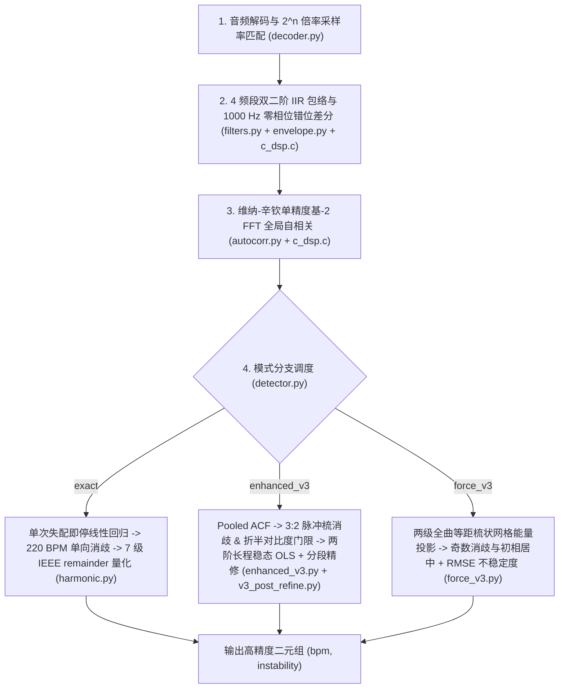

<div align="center">
  
  <h1>基于 Malody 自动测量 BPM 算法的高级 BPM 分析工具</h1>
  <p><strong>Malody-BPM-Analyze-Tool</strong> · <a href="https://github.com/RainyDay10086/Malody-BPM-Analyze-Tool">GitHub 主库</a> · <a href="https://gitee.com/RainyDay10086/Malody-BPM-Analyze-Tool">Gitee 国内镜像</a></p>
  <p>基于 Malody 自动测速算法深入复现与工程增强的本地音频 BPM、节拍不稳定度测算工作台（Web 界面：<code>音频 BPM 深度测算工具</code>）· 集成前 60 秒起峰包络 Offset 慢放精定位</p>
  <p>
    
    
    
    
    
    
    
    
  </p>
</div>

---

## 目录导航

- **使用篇（面向谱师与普通用户）**
  - [项目简介与核心特性](#项目简介与核心特性)
  - [BPM 并不一定是正整数](#bpm-并不一定是正整数)
  - [为什么以 Malody 测速内核为基石](#为什么以-malody-测速内核为基石)
  - [快速开始](#快速开始)
  - [使用指南与测算模式对比](#使用指南与测算模式对比)
  - [仓库目录结构](#仓库目录结构)
- **开发篇（面向二次开发与核心库集成）**
  - [核心信号处理与算法流水线架构](#核心信号处理与算法流水线架构)
  - [C 原生 DSP 动态库编译指南](#c-原生-dsp-动态库编译指南)
  - [Python API 独立调用参考](#python-api-独立调用参考)
  - [独立打包与开源协议声明](#独立打包与开源协议声明)

---

## 项目简介与核心特性

> **双平台成品下载指引（请按平台与系统区分位置）**：
> - **GitHub 主库（[项目主页](https://github.com/RainyDay10086/Malody-BPM-Analyze-Tool)）**：基于 GitHub 平台 25 MB 单文件上传限制及免打包直取考量，**Windows x64 单文件成品 `BPM深度测算工具·基于Malody核心算法.exe` 已直接存放在 GitHub 仓库首页（根目录）**（在仓库主页文件列表点按该文件后，选择右上角 `Download raw file` / `View raw` 即可下载）；**[GitHub Releases](https://github.com/RainyDay10086/Malody-BPM-Analyze-Tool/releases) 中仅提供 macOS x64 安装镜像 `MalodyBPMDetector-macos-x64.dmg`**，不再重复包含 Windows `.exe`。
> - **Gitee 国内镜像（[Gitee 主页](https://gitee.com/RainyDay10086/Malody-BPM-Analyze-Tool)）**：国内网络亦可前往 Gitee 主页网页右侧栏 **「发行」** 下载对应版本，**Windows `.exe` 与 macOS `.dmg` 成品均统一存放在 Gitee「发行」中**（Gitee 仓库根目录不包含 `.exe`）。
> - 两端仓库内的 `output/` 均为空目录，不包含预编译成品；若只是想直接测算 BPM，请勿打包下载源码压缩包，按上方对应位置直接获取成品即可。

**基于 Malody 自动测量 BPM 算法的高级 BPM 分析工具**（仓库英文标识：`Malody-BPM-Analyze-Tool`，启动后浏览器工作台标题：**`音频 BPM 深度测算工具`**）是一款专为音游谱师与音频工程开发者打造的高精度本地离线 BPM、节拍不稳定度及 Offset 辅助定位工作台。

系统采用彻底的前后端解耦架构：
- **本地 Web 工作台（`web_gui*.py`）**：基于 Flask 构建的轻量级桌面浏览器界面，支持批量队列并行管理、三模式同屏对照、纯内存头尾静音无损裁剪、变速与未匹配主干区段诊断，以及脱离浏览器原生音频解码延迟的独立前 60 秒起峰包络慢放 Offset 定位视图。
- **核心测算引擎（`malody_bpm/`）**：与 Web 前端 100% 零耦合的 Python + C11 原生 DSP 计算内核，涵盖与 Malody 官方客户端逐位咬合的 `exact` 模式、直面复杂编曲与切分干扰的高精连续 `enhanced_v3` 模式，以及专治真人演奏/漂移/自由散板曲目的全曲梳状投影 `force_v3` 模式。

### ✨ 核心特性

1. **三模式同屏降维对照（`全部` 模式共享高精度前端流水线）**
   - Web 工作台默认以 **`全部`** 模式运行，一次上传即可同屏呈现三大模式结论；其中 **`增强模式`** 与 **`强制线性回归模式`** 复用同一份高精度多声道浮点解码、静音裁剪结果及 `float64` 起音包络/自相关谱，彻底榨干单次计算耗时；而 **`Malody模式`** 则独立走原版单声道 `s16le` + 硬件 FTZ `float32` 管线，确保对原版结果绝不产生一丝一毫的精度妥协。（界面中 `强制线性回归模式` 卡片默认折叠，仅建议在前两个模式均无法锁定时展开参考。）
   - **Malody模式（`exact`）**：连硬件寄存器都不放过的 100% 原版复刻——单精度 `float32` Direct Form II 双二阶 IIR 级联滤波、硬件级 FTZ（Flush-To-Zero）次正规数清零、单次失配即停线性回归、220 BPM 单向倍频消歧，以及 7 级 IEEE `remainder` 阶梯谐波吸附。
   - **增强模式（`enhanced_v3`）**：日常写谱主力引擎——分窗池化自相关（Pooled ACF）、两阶长程稳态 OLS 精修（含多主干联合 OLS 与残差系统漂移二次修正）、全局 3:2 三连音脉冲梳能量消歧、`240~300` BPM 强弱拍对比度折半保护与未达稳态门槛安全归零；完全摘掉阶梯量化枷锁，直接输出 `[59.99, 300.01]` BPM 闭区间内的高精度连续浮点物理值；若触发三拍子疑似判定或 3:2 消歧，结果卡片会自动附带 `×1.5` / `÷1.5` 备选值一键复制。
   - **强制线性回归模式（`force_v3` / Force Fit）**：最后的兜底铁砧——放弃逐拍局部追踪，直接在全曲时间轴执行等距梳状网格能量投影（Global Comb Projection），经粗扫 Top-5 峰值两级并发精扫、`5×`/`3×` 奇次分谐波平局消歧及非负核初相居中算出全曲宏观平均 BPM（严格按 `2^x` 折叠至 `[59.99, 300.01]` BPM），并依据理论节拍网格与全曲真实起音点残差 RMSE 量化客观不稳定度。

2. **前 60 秒 `diff=1000Hz` 起峰包络 + 零涂抹慢放手动 Offset 定位**
   - 凡有效时长 `≥ 60` 秒的曲目，卡片自动解锁 Offset 定位二级视图：后端精准截取原始音频前 `60.000` 秒单声道 `f32le` PCM（并多预读最多 `0.5` 秒尾部缓冲彻底消除第 60 秒边界的滤波器群延迟畸变），同源提取 `diff=1000Hz` 起峰包络打包为紧凑二进制流（`MOFS`）直传前端——直接绕开浏览器内置音频解码器五花八门的群延迟黑盒。
   - 坚持纯手动高敏微操（无任何自以为是的“自动猜 Offset”或干扰网格线）：支持仿 Adobe Audition 无级滚轮缩放、全局缩略导航条、`0.25x` / `0.5x` / `0.75x` / `1.0x` 倍速慢放（默认采样级原速重采样零时间涂抹，亦可选开启「保持原音调」）、悬停与播放光标毫秒值一键复制，以及自定义包络曲线配色。

3. **内存级头尾静音无损裁剪 & 多声道 4 频段抗反相能量融合**
   - **无损静音裁剪（默认开启）**：按 10 ms 短窗均方能量（RMS）相对全曲峰值分贝阈值裁去首尾静默空白（默认 `-50 dB`，支持 `-70 ~ -25 dB`），并在边界外侧保留 `30 ms` 瞬态保护缓冲绝不误伤首拍鼓点斜坡；可选启用 **「同时处理开头或结尾孤立的极短时间无效振幅」**，精准清除孤立爆音或末尾残响杂音（内置防误裁机制，稳稳留住鼓棒预备拍与稀疏前奏）。裁剪偏移会自动补偿回所有变速时间戳，且绝不改变 Offset 视图对原始曲首的测量基准。
   - **抗反相声道融合**：非 `exact` 模式与 Offset 视图默认启用 `auto`（多声道 4 频段平方能量域融合），彻底消灭立体声反相拓宽造成的中置鼓点正负抵消，同时完整保留 5.1/7.1 环绕声的低频炮（LFE）冲击能量；亦可按需切换 `left`、`right` 或旧版 `downmix`。

4. **变速区域识别 & 严格互补的未匹配主干网格区段**
   - **变速区域识别**：基于 `2^n` 倍频无关的复谐波相量锁定判据独立扫描曲中变速/失锁区间，自动滤除曲首渐入与曲末余音衰减。
   - **未匹配主干网格区段**：增强与强制模式下直接复用逐拍网格命中序列生成未匹配区间与散拍统计，界面严格守恒 **`节拍匹配占比% + 未匹配合计% = 100%`**（界面亦内置说明浮窗，清晰解释其与上方独立 UI 变速区段统计口径叠加可能超过 100% 的原理）。

5. **真实内部封装预检 & 桌面级单实例生命周期**
   - **穿透后缀的白名单预检**：借助 `ffprobe` 直探音频容器封装与纯 C 原生音频编码（哪怕文件被手动修改过后缀名也能一眼识破），严格限制有且仅有 `1` 条音频流（自动无视封面图片与视频流）；一旦检测到原始采样率 `≥ 96 kHz` 或声道数 `> 2`，立刻弹出「超高音质/沉浸声格式」偏差风险确认框防踩坑。
   - **丝滑的桌面化守护**：自带跨平台单实例进程锁（新开实例自动接管并清理旧实例）、`8888` 端口回收与 `+60` 顺延绑定、关闭浏览器标签页约 `2.5` 秒自动清场并优雅退出（刷新页面不退出）、`3` 小时硬性超时看门狗，以及一键直达的两篇离线万字深度指南。

---

## BPM 并不一定是正整数

> ⚠️ **谱师与听众最容易踩进的头号误区**：很多人习惯性地认为“只有音游专属曲目、BMS 或整活曲才会故意设定带小数的速度；普通流行歌、摇滚、ACG、影视原声等**非音游专属曲目，BPM 肯定都是整洁的正整数**”。**这是完全错误的认知，也是大量写谱后期全盘跑偏的罪魁祸首。**

**哪怕是再常规不过的非音游商业音乐，实际 BPM 同样经常不是正整数。** 只要一首歌走出纯电子节拍器的无菌温室，以下任何一种再正常不过的制作环节都会让它的真实物理 BPM 落到小数位置：

1. **编曲或采样本身就是非整数 / 分数速度**
   商业制作人或 Beatmaker 经常直接使用 `122.5`、`133.333...`、`142.08`、`160.99` 这类半整数、三分之一拍或细微小数 BPM；许多基于成品采样 Loop 拉齐拼接的曲目，最终定速更是直接跟随采样切片的原始小数速度走。
2. **混音与母带后期的变速 / 升降调（Varispeed & Pitch-Speed Shift）**
   为了迁就歌手最佳音域、贴合影视画面时长或改变整体听感张力，后期常在不独立锁音高的前提下对全曲做百分比微变速或整体升降半音——一首原本按 `128 BPM` 录完的流行歌，拉快 `+1.2%` 或降半音后，物理 BPM 会立刻变成 **`129.536`** 或 **`120.816`**。
3. **磁带、黑胶、模拟录音与硬件时钟漂移**
   经典老歌、物理磁带/黑胶转录版、实录乐队以及早期硬件编曲机，受马达物理转速微差和晶振偏差影响，实际速度常偏离整数零点几甚至千分之几（例如 `79.995`、`134.925`）。
4. **影视片源制式转换（`23.976` ↔ `24 fps` / PAL ↔ NTSC）**
   从动画 OP/ED、电影原声或 MV 提取的音频，在制式拉片（Pulldown / 4% 加速）过程中速度早已被等比缩放成彻底的无理小数比例，绝不可能再刚好停留在某个正整数上。

**千万别看见小数就“强行四舍五入”！**
以 `140 BPM` 级曲目为例：哪怕真实速度只是 `139.9`（仅差 `0.1 BPM`），你在写谱器里“好心”把它取整写成 `140`，跑到 3 分钟末尾高潮段时节拍网格依然会稳稳错开接近 **`77 ms`**——整段判定直接滑出准度区；若真实速度是 `139.6`，取整成 `140` 不到半分钟就会漂移半拍以上。

**如何在本程序中科学对待小数结果？**
- **`Malody模式（exact）`** 在方差门控达标（`σ_t ≤ 2.4` 且 `rel_inst ≤ 5e-5`）时，会自动启用 **7 级 IEEE `remainder` 阶梯吸附**，把极其接近整数或规范分数（`0.5` / `1/3` / `0.1` / `0.05` / `0.01` / `0.005`）的测算值吸附规整——它擅长洗去普通压缩编码带来的极微毛刺，但也存在“把极度贴近整数的真实小数曲强行吸成整数”的双刃剑效应。
- **`增强模式（enhanced_v3）`** 则**彻底关闭一切阶梯量化吸附**，直接把跨全曲数百拍长基线回归得到的连续物理浮点值原封不动交给你。
- **实战建议**：当 `增强模式` 给出了稳定且明显偏离整数的小数 BPM（尤其是不稳定度良好、与 `Malody模式` 对不上整数时），**请优先信任物理测量小数并放进写谱器长程拉到底校验**，绝不要仅凭“非音游歌应该是个整数”的直觉主观抹零。

---

## 为什么以 Malody 测速内核为基石

市面上大多数面向听歌或泛娱乐场景的测速工具，本质上都在做“波形阈值数鼓点”或“短窗频谱能量投票”：用来粗估个整数或许勉强凑合，可一旦放进**音游写谱器毫秒级刚性等距网格**里，瞬间就会原形毕露、全面失守。

算一笔最残酷的累计相移账：`114 BPM` 的单拍周期约为 `526.316 ms`——哪怕你只错填成 `115 BPM`（单拍仅差区区 `4.58 ms`，耳朵根本听不出快慢），写满 **1 分钟（114 拍）后网格就会累计超前 `521.7 ms`，直接错开整整一拍**；就算误差缩到 `0.1 BPM`，一首 3 分钟曲目写到末尾高潮段依然会硬生生漂移将近 `90 ms`，整段 Note 全成 Good/Miss 翻车现场。

**Malody 原版自动测速算法**（本程序中的 **`Malody模式` / `exact`**）之所以能封神，正是因为它从根子上抛弃了脆弱不堪的“数拍子”，转而锻造了一整条从声学滤波直通统计回归的物理流水线：

1. **4 频段双二阶 IIR 分频提纯 + 采样级群延迟硬对齐**
   原版从不直接拿着混音波形盲找峰，而是将音频劈入 4 路级联 Direct Form II 双二阶滤波器——Band 0（`<600 Hz` 2 级低通，锁住底鼓并附带专用能量平滑）、Band 1（`600~1200 Hz` 4 级带通）、Band 2（`1200~2400 Hz` 4 级带通）与 Band 3（`>2400 Hz` 2 级高通，咬住军鼓与高频镲片）；各路平方能量再施以精确到单个采样点的群延迟补偿（`-320 / -64 / -32 / 0` 采样点）和 `0.30 / 0.20 / 0.20 / 0.30` 黄金权重融合——不管鼓点重音落在轰鸣底鼓还是清脆镲片，瞬态前沿全部严丝合缝叠在同一时刻。
2. **4096-bin IEEE-754 浮点直方图中值自适应去噪**
   在频段累加前，用 `O(N)` 线性时间扫一遍 4096 桶浮点直方图高速截取出各频段底噪中位数，再配合对数动态范围压缩，一刀砍掉长音铺底、浓郁混响和偶发爆音对均值的剧烈干扰，让节拍脉冲干净得像在暗房里打了一束聚光灯。
3. **1000 Hz 毫秒级重采样 + 正反向错位奇对称零相位差分**
   包络重采样到 `1000 Hz`（`1 ms` 分辨率）之后，算法并没有粗暴求相邻一阶差分，而是借正向与反向双二阶递归滤波构造 `bwd[i+1] - fwd[i-1]` 奇对称零相位错位差分——既从物理上彻底消除了 IIR 滤波器天生的相位滞后，又从代数上把中心直流项消得干干净净，只留下一根根只代表“起音前沿斜率”的锐利尖刺。
4. **维纳-辛钦 `2^20` 基-2 FFT 全局自相关 + 跨全曲过原点 OLS 亚毫秒回归**
   通过功率谱逆变换一口气吞下整首歌算全局自相关（ACF），天然无视曲首 Offset 在第几秒、浑然不怕中途漏击几拍，把全曲成百上千次真实击打聚沙成塔，压缩成一条笔直延伸的等距谐波峰簇；再配合抛物线亚采样插值与跨全曲过原点最小二乘回归（`τ = S_kt / S_kk`），借数百拍超长基线充当物理杠杆，直接把主干周期精度稳稳压进亚毫秒乃至微秒级。
5. **双门限方差锁控的 7 级 IEEE `remainder` 阶梯谐波量化**
   针对音游常见的规范速度，算法还布设了一道严格受时间残差标准差 `σ_t ≤ 2.4` 与相对不稳定度 `≤ 5e-5` 联合门控把关的 7 级阶梯吸附（逐级检定整数、`1/2`、`1/3`、`1/10`、`1/20`、`1/100`、`1/200` BPM）。只有曲目稳态过硬才放行吸附，优雅抹除 MP3/AAC 编码或重采样残留的毫厘毛刺。

**青出于蓝的工程超越**：本程序一方面用 C11 对原版 `Malody模式` 的计算管线乃至硬件 FTZ 标志做了 100% 等效还原；另一方面针对原版面对**立体声反相抵消、阶段 3 遇单次切分即脆断、3:2 三连音伪谐波陷阱、中途变速污染与真人演奏游移**时的物理极限，进一步研发出 `增强模式（enhanced_v3）` 与 `强制线性回归模式（force_v3）`。

> 📖 **打开程序后必读内置两篇万字硬核长文（离线即看，支持原生 MathML 数学公式）！**
> 许多直指本质的数学推导与写谱避坑门道在 README 里很难三言两语讲尽。启动工作台后，**初始空白区中央**与**顶栏右上角**均并排常驻了这两枚交互式长文入口：
> - **「BPM、不稳定度算法说明」**：5 大交互专章（*设计初衷与原版缺陷*、*核心概念：自相关 (ACF)*、*BPM 测算原理（三模式）*、*不稳定度公式与解读*、*易忽略局限：古典与钢琴曲*）——把“为什么听着舒缓规整的古典乐和理查德钢琴曲会因**双重频率太低 + Rubato**把常规自相关击穿到底”彻底讲透。
> - **「关于程序不提供多BPM的说明」**：6 大章节与底层证明（*一、局部短变速*、*二、进阶四反问*、*三、连续变速与散板*、*四、Rush E与整活曲*、*五、练琴与古典乐诉求*、*六、底层数学证明*）——用短基线误差 `N^(-3/2)` 放大定律证明，为什么本程序宁可把一条稳态主干算到 `0.001 BPM` 的极限精度，也绝不吐出一堆看似花哨却毫无制谱意义的碎片数字。

---

## 快速开始

### 方式一：直接下载免安装成品（普通用户 / 谱师首选）

1. **按平台与操作系统选择下载位置**（成品均内置完整 Python 运行时、C11 原生 DSP 动态库与精简版 FFmpeg/FFprobe，零环境依赖）：
   - **Windows (x64)**：
     - **GitHub 主库下载**：打开 [GitHub 项目主页](https://github.com/RainyDay10086/Malody-BPM-Analyze-Tool)，直接在仓库**首页（根目录）文件列表**中点按 **`BPM深度测算工具·基于Malody核心算法.exe`**，进入文件页后点按右上角 **`Download raw file`（下载图标）** 或 **`View raw`** 即可下载单文件免安装程序（注：GitHub 主库的 `.exe` 已放在首页根目录，[GitHub Releases](https://github.com/RainyDay10086/Malody-BPM-Analyze-Tool/releases) 页面内不包含 `.exe`）；
     - **Gitee 国内镜像下载**：打开 [Gitee 项目主页](https://gitee.com/RainyDay10086/Malody-BPM-Analyze-Tool)，点按**网页右侧栏的「发行」**下载 **`BPM深度测算工具·基于Malody核心算法.exe`**；
     - **启动运行**：下载后直接双击即可在默认浏览器拉起工作台（默认 `http://127.0.0.1:8888`；单文件首次启动需短暂释放内置组件，若遇 Windows SmartScreen 拦截提示，点按「更多信息 → 仍要运行」即可）。
   - **macOS (x64 Intel / Apple Silicon via Rosetta 2)**：
     1. 前往 **[GitHub Releases](https://github.com/RainyDay10086/Malody-BPM-Analyze-Tool/releases)**（GitHub Releases 仅提供此 macOS 安装包；国内网络亦可前往 [Gitee 项目主页](https://gitee.com/RainyDay10086/Malody-BPM-Analyze-Tool) 右侧栏 **「发行」**）下载镜像 **`MalodyBPMDetector-macos-x64.dmg`**，双击挂载后将 **`MalodyBPMDetector.app`** 拖入 **「应用程序（Applications）」**；
     2. **系统要求**：需 **macOS 14.0（Sonoma）及以上**（内置 NumPy `x86_64` 轮子要求 Mach-O 最低版本 `14.0`）；Intel x64 Mac 原生运行，Apple Silicon（M1–M4）Mac 需已启用系统自带的 **Rosetta 2**；
     3. **首次打开放行**：当前发行包仅含本地 `ad-hoc` 签名（未经过 Apple Developer 付费公证），首次若被 Gatekeeper 拦截，在「访达」中对 `MalodyBPMDetector.app` **右键 → 打开**，或前往 **系统设置 → 隐私与安全性 → 仍要打开**（若仍受隔离属性拦截，终端执行 `xattr -cr /Applications/MalodyBPMDetector.app` 即可）。
2. **用完即走 & 问题反馈**：测算完毕直接关闭浏览器标签页，后台服务会在约 `2.5` 秒后自动清理运行时缓存并安静退出；若遇到测算偏差、运行异常或有改进建议，**作者联系方式已内置在客户端初始首页底部的「温馨提示」栏中**，启动程序后点按号码即可一键复制联系。

---

### 方式二：从源码运行（Python 3.10+）

#### 1. 克隆仓库并安装 Python 依赖
```bash
# GitHub 主库（推荐）
git clone https://github.com/RainyDay10086/Malody-BPM-Analyze-Tool.git
# 或国内镜像：Gitee 仓库
# git clone https://gitee.com/RainyDay10086/Malody-BPM-Analyze-Tool.git

cd Malody-BPM-Analyze-Tool
pip install numpy flask
```

#### 2. 各平台运行时环境说明
- **Windows (x64)**：**开箱即用**。`malody_bpm/` 下已自带精简版 `ffmpeg.exe`、`ffprobe.exe` 与预编译 `c_dsp_x64.dll`，装完 `numpy` 与 `flask` 直接起飞。
- **macOS**：
  - **Intel (`x86_64`) / Rosetta 2 下的 `x86_64` Python**：**开箱即用**。`malody_bpm/` 已自带预编译 `x86_64` 版 `c_dsp.dylib` 与纯 C 静态精简版 `ffmpeg` / `ffprobe`；
  - **Apple Silicon (`arm64` 原生 Python)**：随仓预编译的 `c_dsp.dylib` 为 `x86_64` 单架构，因此需安装 Xcode Command Line Tools（`xcode-select --install`）；首次启动检测到架构不匹配时，程序会自动调用本机 `clang` 即时编译并签名 `arm64` 动态库缓存至系统临时目录（或按下方指南手动重编覆盖 `malody_bpm/c_dsp.dylib`）。随仓 `ffmpeg` / `ffprobe` 可 via Rosetta 2 调用，若通过 `brew install ffmpeg` 装过原生版则会优先走系统 `PATH`。
- **Linux**：需提前安装 `ffmpeg` 与 `gcc`（或 `clang`），并按下方 [C 原生 DSP 动态库编译指南](#c-原生-dsp-动态库编译指南) 手动编出 `malody_bpm/c_dsp.so`。

#### 3. 启动本地 Web 工作台
```bash
python web_gui.py
```

可选启动参数：

| 参数 | 默认值 | 说明 |
| :--- | :--- | :--- |
| `--host` | `127.0.0.1` | 本地 HTTP 服务监听地址 |
| `--port` | `8888` | 起始监听端口（若被占用，先尝试强制终止占用进程回收该端口；仍绑定失败则自动向后顺延最多 60 个端口） |
| `--no-browser` | `False` | 仅启动后台 HTTP 服务，不自动拉起系统默认浏览器 |

---

## 使用指南与测算模式对比

### 音频格式与时长要求
- **支持容器与编码**：`.ogg`（Vorbis / Opus）、`.mp3`、`.flac`、`.wav`（8/16/24/32/64-bit PCM、IEEE Float、`A-law` / `μ-law`）、`.m4a`（AAC / ALAC）、`.aac`、`.opus`（以内部实际解复用与编码结构为准，不轻信文件后缀）。
- **上传与音轨限制**：单文件上传上限 `512 MB`，内部必须有且仅有 **1 条音频流**（自动忽略封面图与视频流）。强烈建议喂给程序标准立体声 SQ 及以下规格音频，避开动辄 ≥ 96 kHz 的“伪超高音质高频底噪”或 6 声道沉浸声干扰。
- **时长限制**：默认严格校验有效时长（开启头尾去静音时按裁剪后时长计算，原始文件安全上限 `1800s`）须落在 **`[45s, 600s]`** 闭区间内。若确实需要测试超短切片或超长串烧，可在顶栏「点按以打开程序设置」中勾选「我愿意承担精确度降低和死机的风险，以测量超短或超长音频」。

### 三大测算模式对照表

| 界面模式名称 | 内部标识 | 核心算法机制 | 阶梯量化 | 适用曲目与选型建议 |
| :--- | :--- | :--- | :---: | :--- |
| **Malody模式** | `exact` | 原版 `float32` FTZ 滤波 + 单次失配即停线性回归 + 220 BPM 单向倍频消歧 | **开启**（7 级 IEEE `remainder` 吸附） | 严格咬合 Malody 官方客户端计算结果，适合原版基准核对 |
| **增强模式** | `enhanced_v3` | 分窗池化自相关 + 两阶稳态 OLS 精修 + 3:2 脉冲梳消歧 + 240~300 BPM 折半对比度门限 | **关闭**（连续输出 `[59.99, 300.01]` 浮点） | **日常写谱与测算首选**；强抗切分/抗弱前奏/抗局部变速，纯散板未达稳态门槛安全归零 |
| **强制线性回归模式** | `force_v3` | 全曲等距梳状网格能量投影（Top-5 两级精扫 + `5×`/`3×` 奇次消歧 + 初相居中）+ 起音残差 RMSE | **关闭**（客观 `2^x` 折叠至 `[59.99, 300.01]`） | 真人实录、轻微 Rubato、极强切分或前两模式均锁不住的复杂曲目最终兜底（`全部` 模式下默认折叠） |

> **Offset 辅助定位小贴士**：曲目有效时长 **≥ 60 秒** 时，结果卡片会点亮 Offset 定位按钮。建议进入二级视图后将倍速调到 `0.5x` 或 `0.25x`，用滚轮放大至首拍鼓点上升沿，听感对齐脉冲尖端读取精确毫秒值。

---

## 仓库目录结构

以下结构与 **GitHub 主库** 及 **Gitee 国内镜像** 完全对齐（不含 macOS `.DS_Store` / `._*` 隐藏元数据缓存及本地专属辅助文件）：
- **`BPM深度测算工具·基于Malody核心算法.exe`**：仅直接存放在 **GitHub 仓库首页（根目录）**（Gitee 镜像根目录不包含此 `.exe`，改由网页右侧栏「发行」提供）；
- **`MalodyBPMDetector-macos-x64.dmg`**：不进入源码目录树，统一存放在 **GitHub Releases** 与 **Gitee「发行」**；
- **`output/`**：在两端仓库中均为空目录，仅用于开发者本地重打包输出。

```text
Malody-BPM-Analyze-Tool/
├── LICENSE                      # MIT 开源协议声明
├── .gitignore                   # Git 忽略规则（排除本地打包临时产物、缓存及平台元数据）
├── README.md                    # 项目总文档（使用指南、目录结构、API 参考与多平台打包说明）
├── BPM深度测算工具·基于Malody核心算法.exe  # [仅 GitHub 根目录] Windows x64 单文件成品（Gitee 请至「发行」下载）
├── app_icon.png                 # 通用应用图标源图（README Logo 及 macOS 打包自动生成 .icns 之源）
├── app_icon.ico                 # Windows 桌面端应用图标资源
├── web_gui.py                   # Flask Web GUI 主入口（音频 BPM 深度测算工具）、队列调度与端口管理
├── web_gui_settings.py          # 「测算设置」参数真值表、表单强校验与设置弹窗注入模块
├── web_gui_precheck.py          # ffprobe 真实封装/编码白名单预检、风险弹窗与流式状态推送
├── web_gui_silence.py           # 10ms RMS 头尾静音与孤立短振幅内存级无损裁剪模块
├── web_gui_offset.py            # 前 60 秒 diff=1000Hz 起峰包络 (MOFS) 与慢放 Offset 二级视图
├── web_gui_tempo_regions.py     # 基于 2^n 倍频无关复谐波相量锁定的变速/失锁区段识别模块
├── web_gui_unmatched.py         # 与匹配占比严格互补（合计 100%）的未匹配主干网格区段模块
├── web_gui_lifecycle.py         # 跨平台单实例守护锁、标签页关闭 2.5s 退出与 3h 看门狗
├── web_gui_algo_doc.py          # 内置《BPM、不稳定度算法说明》与《不提供多BPM说明》双交互弹窗
├── output/                      # 本地独立打包输出目录（仓库中为空目录，打包后生成 .exe / .app / .dmg）
├── packaging/                   # PyInstaller / auto-py-to-exe 跨平台独立打包脚本、Spec 与专用 Hook
│   ├── auto_py_to_exe_windows_x64.json      # Windows x64 auto-py-to-exe 配置 (--onedir 默认目录版)
│   ├── MalodyBPMDetector_macos_x64.spec     # macOS x64 PyInstaller --onedir .app 规格文件
│   ├── build_minimal_ffmpeg_macos_x64.sh    # 精简版 FFmpeg 9.0.2 (x86_64) 纯 C 源码静态构建脚本
│   ├── build_macos_x64.sh                   # macOS x64 自动制标、/tmp 隔离签名与 DMG 镜像打包脚本
│   └── hooks/hook-malody_bpm.py             # PyInstaller 自动收集子模块、滤波器表、c_dsp 与 FFmpeg 的 Hook
└── malody_bpm/                  # 与 Web 前端 100% 解耦的核心 BPM 测算 Python 包
    ├── __init__.py              # 导出核心入口 detect_bpm
    ├── detector.py              # 核心测算流水线调度与 18 项参数校验
    ├── decoder.py               # FFmpeg/FFprobe 调用与 2^n 倍率智能采样率匹配解码
    ├── filters.py               # 滤波器系数加载与 c_dsp 原生库检索/自动编译 (macOS/Win)
    ├── filter_coeffs.json       # 4 频段双二阶 IIR 滤波器系数表 (32k / 44.1k / 48k)
    ├── c_dsp.c                  # C11 原生 DSP 算子源码 (滤波、包络、基-2 FFT 自相关、追踪回归)
    ├── c_dsp.dylib              # 随仓预编译的 macOS Intel (x86_64) 原生 DSP 动态库
    ├── c_dsp_x64.dll            # 随仓预编译的 Windows x64 原生 DSP 动态库
    ├── envelope.py              # 4 频段起音包络提取与零相位奇对称 IIR 错位差分滤波
    ├── autocorr.py              # 维纳-辛钦 FFT 自相关、抛物线峰搜与不稳定度估算
    ├── harmonic.py              # 原版 7 级 IEEE remainder 阶梯谐波量化模块
    ├── enhanced_v3.py           # 增强 V3 融合测速核心 (Pooled ACF + 长程 OLS + 3:2/折半消歧)
    ├── v3_post_refine.py        # V3 残差系统漂移检测与分段斜率二次精修
    ├── force_v3.py              # Force Fit V3 全局梳状网格能量投影与 RMSE 拟合核心
    ├── enhanced.py              # 历史增强 V1 内核 (向后兼容保留)
    ├── enhanced_v2.py           # 历史增强 V2 内核 (向后兼容保留)
    ├── ffmpeg / ffprobe         # 随仓精简编译的 macOS x64 纯 C 音频解码与探测工具 (FFmpeg 9.0.2)
    └── ffmpeg.exe / ffprobe.exe # 随仓精简编译的 Windows x64 纯 C 音频解码与探测工具
```

---

## 核心信号处理与算法流水线架构



1. **解码与 `2^n` 倍率采样率匹配（`decoder.py`）**：
   系统内置 `48000` / `44100` / `32000` Hz 三组精确滤波器系数。遇到 `96000` / `88200` / `22050` / `16000` Hz 等非标采样率时，优先按 `2^n` 整数倍频精确缩放至三者之一，避开非整数重采样的分数相位畸变。`exact` 模式固定按单声道 `s16le` 混音；非 `exact` 模式默认解码保留原始多声道浮点流交由 C 内核处理。
2. **4 频段包络与零相位错位差分（`filters.py` + `envelope.py` + `c_dsp.c`）**：
   信号经 Band 0~3 四组级联双二阶滤波器后，进行能量平方化（非 `exact` 多声道逐声道平方后求均值以防反相抵消）、4096-bin 浮点直方图中值去噪、对数压缩、群延迟对齐累加及末端低通平滑，随后重采样至 `1000 Hz`（`1 ms/sample`）并执行前向-反向零相位错位差分。`exact` 模式运行还原硬件 FTZ 标志的 `float32` 状态机，其余模式全部升级为 `float64` 双精度状态机以根除长曲舍入漂移。
3. **维纳-辛钦 FFT 全局自相关（`autocorr.py` + `c_dsp.c`）**：
   全模式统一调用 C 原生单精度基-2 蝶形 FFT（`2^20` 预计算旋转因子表）求解全局自相关，仅保留重叠度 ≥ 50% 的前半程 `n // 2` 滞后窗（超长输入自动截断至约 `699` 秒以严守 `2^20` FFT 边界）。
4. **周期搜寻、回归与折叠输出**：
   - `exact` 模式若启用 `octave_norm=True`，按 `[110, 220]` BPM 倍频折叠并执行 7 级 IEEE `remainder` 阶梯吸附；
   - `enhanced_v3` 与 `force_v3` 完全关闭阶梯吸附并忽略 `octave_norm`，严格按客观 `2^x` 规则折叠至 **`[59.99, 300.01]` BPM** 闭区间，保留完整连续小数精度。

---

## C 原生 DSP 动态库编译指南

`malody_bpm` 强依赖原生 C11 动态库执行滤波器状态机、4096-bin 中值统计、基-2 FFT 自相关及回归运算（核心包不提供纯 Python 慢速回退路径）。

### 动态库加载优先级
`filters.py` 按以下顺序加载动态库：
1. 若设置了环境变量 `MALODY_C_DSP_PATH`，优先直接加载该指定路径；
2. 依次检索包目录、项目根目录及 PyInstaller 冻结打包目录中的预编译动态库：
   - **Windows**：`c_dsp_x64.dll` / `c_dsp_arm64.dll` / `c_dsp.dll`（仓库已自带 `malody_bpm/c_dsp_x64.dll`）
   - **macOS**：`c_dsp.dylib` / `c_dsp_{arch}.dylib`（仓库已自带 Intel `x86_64` 版 `malody_bpm/c_dsp.dylib`）
   - **Linux**：`c_dsp_{arch}.so` / `c_dsp.so`
3. **即时自动编译缓存（仅限 macOS 与 Windows）**：若上述位置均未命中或因架构不匹配/系统策略拦截加载失败，程序会尝试调用本机编译器（macOS 下定位 `clang` 并自动执行 `codesign --force --sign -`；Windows 下依次尝试 `clang`、`gcc`、`cl`）按 `c_dsp.c` 的 SHA-256 哈希即时编译并缓存到系统临时目录。**注意：Linux 平台未配置自动编译分支，使用前需先行手动编出 `.so`。**

### 跨平台手动编译命令（请在仓库根目录执行）

> ⚠️ **关键浮点编译约束**：为保障跨平台滤波数值逐位对齐，编译时**必须禁用 FMA 乘加融合并关闭快速浮点优化**（Clang/GCC 加 `-ffp-contract=off -fno-fast-math`，MSVC 加 `/fp:strict`）。

#### Linux (`x86_64` / `aarch64`)
```bash
gcc -O3 -ffp-contract=off -fno-fast-math -fPIC -shared malody_bpm/c_dsp.c -o malody_bpm/c_dsp.so -lm
```

#### macOS (`x86_64` / `arm64` / `universal2`)
仓库已随仓提供预编译 Intel (`x86_64`) 版 `malody_bpm/c_dsp.dylib`。修改 `c_dsp.c` 或需编译原生 `arm64` / 双架构通用动态库时执行：
```bash
# 编译 x86_64 切片（构建原生 arm64 或双架构通用库可将 -arch 改为 arm64 或同时传入 -arch arm64 -arch x86_64）
clang -arch x86_64 -mmacosx-version-min=10.13 \
  -O3 -ffp-contract=off -fno-fast-math -dynamiclib \
  -install_name @rpath/c_dsp.dylib \
  malody_bpm/c_dsp.c -o malody_bpm/c_dsp.dylib -lm

# 执行本地 ad-hoc 签名，防止 macOS Gatekeeper 拦截加载
codesign --force --sign - malody_bpm/c_dsp.dylib
```

#### Windows (`x64` / `arm64`)
仓库已随仓提供预编译 `malody_bpm/c_dsp_x64.dll`。修改 `c_dsp.c` 或需面向 Windows ARM64 编译时运行：
```bat
:: 方式 A：使用 MSVC (x64 Native Tools Command Prompt)
cl /nologo /O2 /fp:strict /LD malody_bpm\c_dsp.c /Fe:malody_bpm\c_dsp_x64.dll

:: 方式 B：使用 Clang 或 MinGW-w64 GCC
gcc -O3 -ffp-contract=off -fno-fast-math -shared malody_bpm\c_dsp.c -o malody_bpm\c_dsp_x64.dll
```

---

## Python API 独立调用参考

`malody_bpm` 包可彻底脱离 Flask Web 前端独立导入调用（确保运行环境已安装 `numpy`，且 `PATH` 可访问 `ffmpeg` 或使用随仓 `malody_bpm/ffmpeg.exe`〔Windows〕/ `malody_bpm/ffmpeg`〔macOS x64〕）：

```python
from malody_bpm import detect_bpm

# 1. 默认 Malody 原版复刻模式 (exact)
bpm_exact, instab_exact = detect_bpm("path/to/audio.ogg")
print(f"Exact: BPM={bpm_exact:.2f}, Instability={instab_exact:.2f}")

# 2. 推荐增强 V3 模式 + 多声道抗反相融合 + 接收详细诊断元数据
meta = {}
bpm_v3, instab_v3 = detect_bpm(
    "path/to/audio.flac",
    mode="enhanced_v3",
    channel="auto",
    transition_guard=1.0,
    trim_recalc=True,
    meta=meta,
)
print(
    f"Enhanced V3: BPM={bpm_v3:.4f}, Instab={instab_v3:.4f}, "
    f"Stage={meta.get('stage')}, Triple={meta.get('suspected_triple_meter')}"
)

# 3. 强制线性回归模式 (force_v3)，并解除 45~600s 时长限制
bpm_force, instab_force = detect_bpm(
    "path/to/live_recording.mp3",
    mode="force_v3",
    allow_any_duration=True,
)
```

> 注：Web 工作台默认启用 `mode="all"` 与 `trim_recalc=True`；而独立 Python API `detect_bpm(...)` 为保持向后兼容，默认参数为 `mode="exact"` 与 `trim_recalc=None`（随 `transition_guard > 0` 自动开启）。

### 返回值说明
函数固定返回二元组 **`(bpm, instability)`**（`tuple[float, float]`）：
- 测算成功时：`bpm` 为最终节拍速度，`instability` 为对应的节奏不稳定度；
- 面对纯散板、无周期鼓点或未过稳态门槛导致无法测算时：`bpm` 返回 `0.0`，其中 `exact` 模式返回 `(0.0, 0.0)`，其余所有模式返回 `(0.0, 1.0)`。

### `detect_bpm(...)` 全部 18 个参数规格

| 参数名 | 类型与默认值 | 允许范围 / 可选值 | 生效模式与行为说明 |
| :--- | :--- | :--- | :--- |
| `audio_path` | `str`（必填） | 本地音频文件路径 | 支持 `ffmpeg` 可解复用解码的音频文件 |
| `target_sr` | `int \| None = None` | 整数采样率或 `None` | 为 `None` 时自动按 `2^n` 倍率智能匹配 `48000` / `44100` / `32000` Hz |
| `octave_norm` | `bool = False` | `True` / `False` | 仅在 `exact` / `enhanced` / `enhanced_v2` 生效（`exact` 折叠至 `[110, 220]` BPM）；**在 `enhanced_v3` 与 `force_v3` 中被忽略**，恒按客观 `2^x` 规则折叠至 `[59.99, 300.01]` BPM |
| `mode` | `str = "exact"` | `"exact"`、`"enhanced_v3"`、`"force_v3"`（兼容别名见下） | 核心算法模式；`enhanced_v3` 支持别名 `enhanced3`/`v3_enhanced`/`enh_v3`；`force_v3` 支持别名 `force_fit`/`v3`；保留向后兼容的历史模式 `"enhanced"`（V1）与 `"enhanced_v2"`（`enhanced2`/`v2`） |
| `channel` | `str = "auto"` | `"auto"` / `"left"` (`"l"`) / `"right"` (`"r"`) / `"downmix"` | 声道分析策略；**在 `exact` 模式下仅校验参数合法性并静默忽略**，恒走单声道线性混音 |
| `allow_any_duration` | `bool = False` | `True` / `False` | 全模式默认严格校验解码后 PCM 时长须在 `[45s, 600s]` 内；设为 `True` 可解除限制 |
| `track_tol` | `int = 8` | `5 ~ 25`（整数 ms） | 仅 `enhanced_v2` / `enhanced_v3` 生效：自相关谐波峰值追踪与线性回归左右容差 |
| `comb_tol` | `int \| None = None` | `10 ~ 50`（整数 ms）或 `None` | 仅 `enhanced_v2` / `enhanced_v3` / `force_v3` 生效：时域脉冲梳匹配半宽（`None` 时默认 `35` ms） |
| `acf_decay_ratio` | `float = 0.7` | `0.1 ~ 1.0` | 仅 `enhanced_v3` 生效：初筛谐波链均值相对首峰强度的最低衰减保留比 |
| `cand_update_ratio` | `float = 1.25` | `1.0 ~ 2.0` | 仅 `enhanced_v3` 生效：更慢长周期候选取代当前快速候选所需的强度倍率门槛 |
| `halve_contrast_ratio` | `float = 1.10` | `1.0 ~ 2.0` | 仅 `enhanced_v3` 生效：首次定位于 `240 ~ 300.01+` BPM 时触发折半判定的强弱拍对比度门限（`220~240` BPM 恒不折半；`1.0` 遇到半速候选即折半，`2.0` 几乎从不折半） |
| `transition_guard` | `float \| int \| None = None` | `float` `0.0~3.0`(s) 或 `int` `0~3000`(ms) / `None` | 仅 `enhanced_v2` / `enhanced_v3` / `force_v3` 生效：变速边界过渡内缩保护时长，`None` 或 `0` 为关闭 |
| `transition_miss_beats` | `int = 4` | `2 ~ 10`（整数拍） | 仅 `enhanced_v2` / `enhanced_v3` / `force_v3` 生效：连续未命中判定进入变速失锁的拍数门限 |
| `transition_resume_beats` | `int = 3` | `2 ~ 10`（整数拍） | 仅 `enhanced_v2` / `enhanced_v3` / `force_v3` 生效：连续命中判定恢复稳态（a tempo）的拍数门限 |
| `trim_recalc` | `bool \| None = None` | `True` / `False` / `None` | 仅 `enhanced_v3` / `force_v3` 生效：剔除变速段后重锁相位并二次重算开关；`None` 时随 `transition_guard > 0` 自动开启 |
| `sub_trunk_min_sec` | `int = 15` | `8 ~ 15`（整数秒） | 仅 `enhanced_v3` 生效：副主干进入二次多主干联合 OLS 精修所需的最小有效时长 |
| `groove_tol` | `int \| None = None` | `5 ~ 60`（整数 ms）或 `None` | 仅历史 `enhanced`（V1）模式生效，用于手动覆盖有效节拍允许偏差门限 |
| `meta` | `dict \| None = None` | 可变字典或 `None` | 传入字典时将就地写入详细诊断信息（如 `stage`、`raw_bpm`、`bpm`、`n_matched`、`coverage`、`rmse_ms`、`transition_spans`、`suspected_triple_meter`、`ratio_up`/`ratio_down` 等） |

---

## 独立打包与开源协议声明

> **再次提示**：普通用户无需自行打包——Windows 用户请前往 [GitHub 仓库首页](https://github.com/RainyDay10086/Malody-BPM-Analyze-Tool) 下载根目录 `.exe`，macOS 用户请前往 [GitHub Releases](https://github.com/RainyDay10086/Malody-BPM-Analyze-Tool/releases) 下载 `.dmg`（国内网络亦可前往 [Gitee 镜像主页](https://gitee.com/RainyDay10086/Malody-BPM-Analyze-Tool) 右侧栏 **「发行」** 下载双端成品）；以下章节仅供二次开发后需自行重打包的开发者参考。

### Windows x64 独立打包（PyInstaller / auto-py-to-exe）

仓库在 `packaging/` 下内置了完整打包规则与专用 Hook：
- **使用 `pyinstaller` CLI 构建单文件 `.exe`（与分发单文件成品同款形态）**：
  配合 [`packaging/hooks/hook-malody_bpm.py`](./packaging/hooks/hook-malody_bpm.py) 自动收集全部子模块、`filter_coeffs.json`、`c_dsp.c`、平台动态库以及 `ffmpeg.exe` / `ffprobe.exe`（改目录版只需将 `--onefile` 换成 `--onedir`）：
  ```bash
  pyinstaller --noconfirm --onefile --windowed --clean ^
    --name "BPM深度测算工具·基于Malody核心算法" --icon app_icon.ico ^
    --additional-hooks-dir packaging/hooks ^
    --hidden-import web_gui --hidden-import flask --hidden-import werkzeug.serving ^
    --hidden-import web_gui_algo_doc --hidden-import web_gui_lifecycle ^
    --hidden-import web_gui_offset --hidden-import web_gui_precheck ^
    --hidden-import web_gui_settings --hidden-import web_gui_silence ^
    --hidden-import web_gui_tempo_regions --hidden-import web_gui_unmatched ^
    web_gui.py
  ```
- **使用 `auto-py-to-exe`（默认目录版配置）**：
  1. 安装依赖：`pip install auto-py-to-exe pyinstaller`
  2. 在项目根目录运行 `auto-py-to-exe` 并导入 [`packaging/auto_py_to_exe_windows_x64.json`](./packaging/auto_py_to_exe_windows_x64.json) 即可加载全部入口、图标与排除项（该配置默认输出 `--onedir` 目录版至 `output/MalodyBPMDetector/`，若需单文件版可在界面中切换并自定输出名称）。

### macOS x64 独立打包（精简版 FFmpeg + PyInstaller + DMG）

在仓库根目录依次准备环境并运行脚本即可生成本地 `.app` 与 `.dmg` 产物至 `output/`：

1. **准备打包环境**：
   - 安装 Xcode Command Line Tools（提供 `clang`、`codesign`、`sips`、`iconutil`、`hdiutil`）：`xcode-select --install`；
   - 安装带 **`x86_64` 切片**的 Python 运行时与依赖（`numpy`、`flask`、`pyinstaller`；Apple Silicon 设备可用 `universal2` Python 配合 `arch -x86_64` 或独立 `x86_64` 虚拟环境执行）；
   - 如需重编精简版 FFmpeg，另需安装汇编器 `nasm`（`brew install nasm`）。
2. **（可选）重编精简版 `x86_64` FFmpeg / FFprobe**：
   仓库已内置编译好的 `malody_bpm/ffmpeg` 与 `malody_bpm/ffprobe`；仅需升级或调整裁剪清单时运行：
   ```bash
   ./packaging/build_minimal_ffmpeg_macos_x64.sh
   ```
   脚本将从 FFmpeg `9.0.2` 官方源码静态构建零第三方 `.dylib` 依赖（仅链接 macOS 系统 `libSystem` / `libz` 及系统框架）的纯 C `x86_64` 二进制并写入 `malody_bpm/`。
3. **一键生成图标、`.app` 与 `.dmg` 镜像**：
   ```bash
   ./packaging/build_macos_x64.sh
   ```
   - **自动制标与架构校验**：由于 GitHub 与 Gitee 源码仓库中均未预置 `packaging/app_icon.icns`，脚本会在第 `[2/6]` 步自动调用 macOS 原生 `sips` 与 `iconutil` 从根目录 `app_icon.png` 生成 `packaging/app_icon.icns`；同时检查并按需编译 `x86_64` 版 `malody_bpm/c_dsp.dylib`（`-mmacosx-version-min=10.13`）、校验 `ffmpeg` / `ffprobe` 架构纯净度，最后调用 [`packaging/MalodyBPMDetector_macos_x64.spec`](./packaging/MalodyBPMDetector_macos_x64.spec) 与 [`packaging/hooks/hook-malody_bpm.py`](./packaging/hooks/hook-malody_bpm.py) 构建 `--onedir` `target_arch="x86_64"` 的 `.app`；
   - **最低系统版本 `14.0`**：现代 PyPI `x86_64` 版 NumPy 二进制轮子的 Mach-O 最低系统要求为 macOS `14.0`，打包 Spec 已将 `LSMinimumSystemVersion` 显式锁定为 `14.0`；
   - **iCloud Drive 扩展属性与签名避坑**：若工程放在 iCloud Drive 同步目录，系统 File Provider 会注入 `com.apple.FinderInfo` / `com.apple.fileprovider.fpfs#P` 扩展属性并直接导致 `codesign` 报错中止。`build_macos_x64.sh` 已内置 `/tmp/` 隔离构建流——先在 `/tmp/` 完成打包、清理扩展属性、深度 `ad-hoc` 签名（`codesign --verify --deep --strict`）及 `hdiutil` 压制镜像，再将纯净的 `MalodyBPMDetector.app` 与 `MalodyBPMDetector-macos-x64.dmg` 输出至 `output/`（对外分发建议优先分发 `.dmg` 镜像，避免直接拷贝 `.app` 破坏签名）。

### 环境变量速查

| 环境变量 | 默认行为 | 用途说明 |
| :--- | :--- | :--- |
| `MALODY_C_DSP_PATH` | 按包目录、项目根目录及即时编译缓存顺序查找 | 显式指定自定义编译的 `c_dsp` 动态库绝对路径 |
| `MALODY_FFMPEG_BIN` / `FFMPEG_BINARY` | 依次查找环境变量、`PATH`、随仓/打包目录及常见安装路径 | 显式指定 `ffmpeg` 可执行文件路径 |
| `MALODY_FFPROBE_BIN` / `FFPROBE_BINARY` | 依次查找环境变量、`PATH`、随仓/打包目录及常见安装路径 | 显式指定 `ffprobe` 可执行文件路径 |
| `MALODY_BPM_AUTO_EXIT_SECONDS` | `10800`（3 小时） | 覆盖本地 Web 服务运行上限看门狗超时秒数 |

### 开源协议与第三方合规声明
- **本项目开源协议**：本项目源代码基于 **MIT License** 开源，详见仓库根目录 [`LICENSE`](./LICENSE)。
- **独立性与非官方声明**：本项目为面向音游社区与音频信号处理研究的独立开源工具，**与 Malody 官方无任何隶属、合作或授权关系**；程序内部不包含亦不修改任何第三方商业软件原始文件，其中 `exact` 模式仅基于声学与信号处理原理复现同类计算管线，供社区谱师研究与对照参考。
- **问题反馈与联系作者**：为避免公开网页被爬虫抓取，作者联系方式（支持点按一键复制）**已直接内置于客户端初始首页底部的「温馨提示」栏第 4 项**；如在使用中发现测算异常、打包问题或有功能建议，欢迎启动客户端查看联系（亦可直接在 [GitHub Issues](https://github.com/RainyDay10086/Malody-BPM-Analyze-Tool/issues) 或 [Gitee 仓库 Issue](https://gitee.com/RainyDay10086/Malody-BPM-Analyze-Tool/issues) 提交反馈）。
- **FFmpeg 第三方合规声明**：随仓库分发的 `malody_bpm/ffmpeg.exe`、`malody_bpm/ffprobe.exe`（Windows x64）与 `malody_bpm/ffmpeg`、`malody_bpm/ffprobe`（macOS x64）均为去除所有外部 GPL / 非自由编码库、仅启用纯 C 原生组件自编译的精简版 FFmpeg 9.0.2 二进制程序（macOS 端由 [`packaging/build_minimal_ffmpeg_macos_x64.sh`](./packaging/build_minimal_ffmpeg_macos_x64.sh) 构建，仅保留 `ogg` / `mp3` / `flac` / `wav` / `mov` / `aac` 解复用器、22 个纯 C 音频解码器、基础滤镜与 `zlib` / `pthreads` 支持，无第三方动态库依赖），遵循 **GNU LGPL v2.1 or later** 协议，本软件仅通过独立子进程管道方式调用。
- **致谢**：向 **Malody** 及其高精度音频测速思路致敬。
